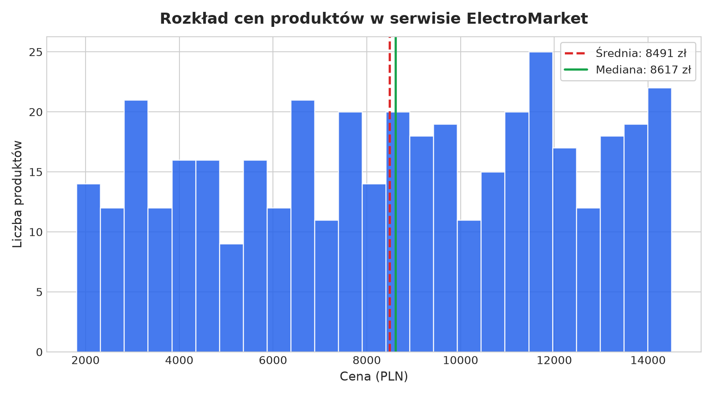
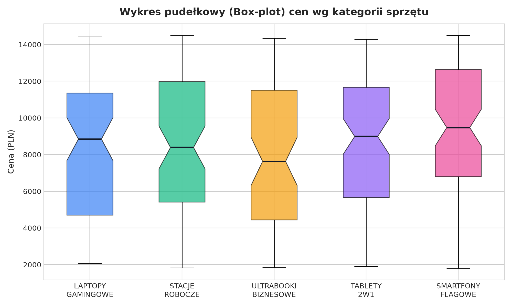
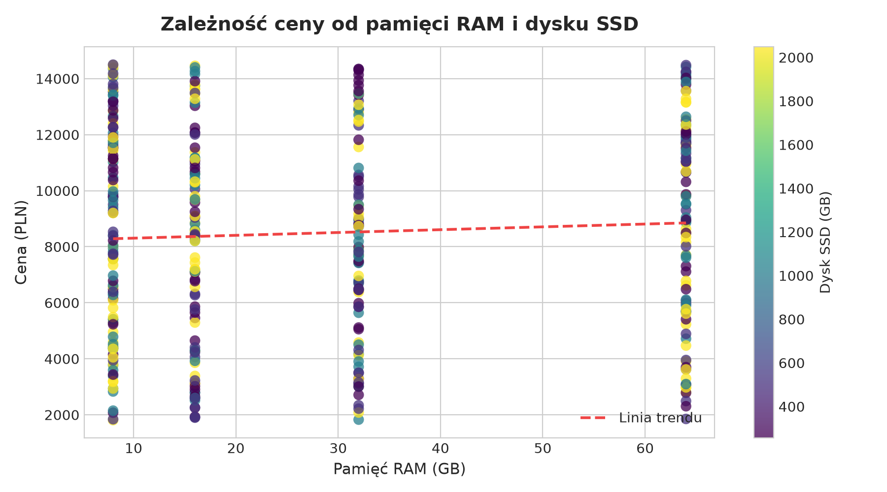

# Sprawozdanie — Laboratorium nr 1: Web Scraper & Serwis WWW (Poziom 5.0)

**Przedmiot:** Przetwarzanie Języka Naturalnego 

**Autorzy projektu:** Gabriela Błaut, Michał Brzeziński 

**Temat projektu:** Budowa serwisu e-commerce (ElectroMarket) oraz asynchronicznego parsera opartego o Selenium  

**Uzyskany poziom trudności:** 5.0 

**Data realizacji:** 20.10.2026  

---

## 1. Użyte technologie i uzasadnienie wyboru

Projekt uruchomiono w środowisku **Python 3.12.3**:

* **Python + Selenium WebDriver (Google Chrome)** — Serwis internetowy na poziomie 5.0 w całości wstrzykuje produkty przez JavaScript po wykonaniu zapytań `fetch()`. Klasyczne biblioteki takie jak `requests` czy `BeautifulSoup` widzą pusty dokument HTML. Selenium z prawdziwym silnikiem przeglądarki Chrome było konieczne, aby wykonać skrypty JS, zasymulować klikanie przycisku „Wczytaj więcej” i odczekać na wyrenderowanie drzewa DOM.
* **Wielowątkowy serwer Python (`socketserver.ThreadingTCPServer`) z własnym limiterem** — Odpowiedź po przekroczeniu limitu zawiera kod HTTP 429, nagłówek `Retry-After` oraz tę samą wartość w treści odpowiedzi, którą może odczytać Selenium.
* **Pandas & NumPy** — Wykorzystane do czyszczenia danych, weryfikacji braków, wykrywania duplikatów i obliczenia statystyk opisowych. Cena analizowana jest w PLN; kwota i waluta źródłowa pozostają zachowane w osobnych kolumnach.
* **Matplotlib** — Do wygenerowania wymaganych wykresów (histogram, box-plot, korelacja).
* **OpenPyXL** — Do natywnego eksportu do pliku `.xlsx`, aby arkusze kalkulacyjne nie przekłamywały typów danych.
* **Pytest** — Do napisania 22 testów jednostkowych weryfikujących czyszczenie, walidację, deduplikację i obsługę odpowiedzi 429.

---

## 2. Opis zbudowanego serwisu (Rola: AUTOR)

Zbudowaliśmy fikcyjny sklep z elektroniką **ElectroMarket**, który serwuje bazę **420 produktów**. Każdy rekord źródłowy JSON ma 28 pól; po ekstrakcji i normalizacji powstaje 27 kolumn, w tym cena w PLN, kwota źródłowa i waluta.

```
Użytkownik / Przeglądarka
   │
   ├──> GET / (index.html) -> Pusty kontener HTML (0 produktów)
   │
   ├──> JS catalog.js -> fetch("data/products.json")
   │       └──> Kliknięcie "Wczytaj więcej" -> porcje po 35 sztuk (opóźnienie 400-1100 ms)
   │
   └──> GET /product.html?id=X
           └──> JS product.js -> dynamiczne wstrzyknięcie 12 cech ogólnych 
                + 12 cech specyfikacji w interaktywnym elemencie <details>
```

### Wybrane utrudnienia (zgodnie z wytycznymi na 5.0 i 4.0):
1. **Dynamiczne wstrzykiwanie przez JS (Wymóg 5.0):** Rekordy produktów nie istnieją w pliku HTML. W źródle strony (Ctrl+U) znajduje się tylko szkielet strony, a dane ładują się asynchronicznie z pliku JSON.
2. **Doładowywanie porcjami („Wczytaj więcej”) zamiast statycznej paginacji:** Produkty ładują się partiami po 35 sztuk po kliknięciu przycisku, ze sztucznym losowym opóźnieniem w przedziale 400–1100 ms. Na samym dole bazy pojawia się znacznik `#end-message`.
3. **Cechy widoczne dopiero po interakcji (`<details>`):** Na podstronie produktu pełna specyfikacja techniczna jest ukryta w elemencie `<details>`. Parser musi kliknąć `<summary>`, aby odsłonić dane.
4. **Losowa kolejność atrybutów:** Skrypt `product.js` miesza kolejność cech w tabeli specyfikacji przy każdym wejściu na stronę (algorytm Fisher-Yates), więc parser nie może polegać na stałej pozycji indeksu w HTML, tylko na atrybutach semantycznych.
5. **Dedykowany serwer z kodem HTTP 429 i `Retry-After`:** Jeśli scraper wyśle więcej niż 10 zapytań na sekundę, serwer odrzuca ruch kodem `429 Too Many Requests` i zwraca nagłówek `Retry-After: 2`.
6. **Kontrola zasad dostępu:** Przed uruchomieniem przeglądarki parser pobiera `robots.txt` i regulamin, blokuje ścieżki niedozwolone przez robots.txt oraz respektuje większy z wymaganych odstępów: `Crawl-delay` lub minimum z regulaminu.
7. **Zduplikowane rekordy:** W bazie celowo umieszczono **10 duplikatów** z różnymi technicznymi ID, ale identycznymi danymi biznesowymi.
8. **Niespójne formaty i braki danych:** Daty zapisane jako `YYYY-MM-DD`, `DD.MM.YYYY`, `wczoraj` oraz `X dni temu`. Ceny w różnych walutach (PLN, EUR, USD) z twardymi spacjami i encjami HTML (`&nbsp;`). Braki w `liczba_opinii` i `gwarancja_miesiace` przekraczają 15%.

---

## 3. Opis parsera (Rola: PARSER)

Parser składa się ze zintegrowanego potoku modularnego:
* `CatalogScraper` — Zarządza doładowywaniem listy głównej i zbiera unikalne odnośniki do produktów.
* `ProductScraper` — Odwiedza każdą podstronę, rozwija specyfikację i pobiera 27 cech.
* `cleaners.py` — Czyści i standaryzuje surowe ciągi znaków.
* `validators.py` — Sprawdza poprawność typów i wartości brzegowych.
* `deduplicator.py` — Usuwa powtórzone rekordy.
* `exporter.py` — Zapisuje dane do CSV, JSON i XLSX.

### Zastosowane selektory i ocena ich odporności

| Element / Dana | Użyty selektor | Odporność na zmiany wyglądu (CSS/Layout) | Uzasadnienie |
| :--- | :--- | :---: | :--- |
| Przycisk doładowania | `By.ID, "btn-load-more"` | **Bardzo wysoka** | Identyfikator techniczny ID; zmiana stylów CSS, kolorów czy położenia przycisku nie psuje selektora. |
| Komunikat końca | `By.ID, "end-message"` | **Bardzo wysoka** | Prosty znacznik stanu ID. |
| Rozwijanie cech | `By.ID, "tech-specs-toggle"` | **Bardzo wysoka** | Celowy ID elementu interaktywnego. |
| Cechy specyfikacji | `.spec-item[data-spec-key]` | **Bardzo wysoka** | **Najbardziej odporny selektor w projekcie**. Zamiast brać np. `div:nth-child(3)`, czytamy klucz z `data-spec-key="ram_gb"`. Nawet jeśli kolejność cech jest losowa lub zmieni się układ tabeli, pobieramy właściwy parametr. |
| Nazwa, Kategoria, Cena | Klasy semantyczne: `.nazwa`, `.kategoria`, `.cena` | **Wysoka** | Klasy semantyczne przetrwają zmianę fontów, kolorów i układu siatki (Grid/Flexbox). Przetrwałyby dopóki programista nie zmieni nazewnictwa klas w szablonie. |
| Karty produktów | `By.CSS_SELECTOR, ".produkt"` | **Wysoka** | Zastosowano uniwersalną klasę wspólną zarówno dla kart `article`, jak i wierszy tabeli `tr`. |

---

## 4. Porównanie surowego HTML z drzewem DOM (Wymóg 5.0)

W ramach weryfikacji wymogu poziomu 5.0 przeprowadziliśmy test porównawczy:
1. Pobranie strony głównej standardowym zapytaniem HTTP bez przeglądarki (`urllib.request` / `requests.get`).
2. Pobranie strony głównej po pełnym wykonaniu skryptów w przeglądarce Selenium.

<!-- AUTO:HTML_COMPARISON:START -->
| Metoda pobrania strony | Liczba znalezionych rekordów produktów w HTML | Komentarz i wnioski |
| :---: | :---: | :---: |
| **Surowy HTML (bez JS / requests)** | 0 | Źródłowy `index.html` nie zawiera wyrenderowanych rekordów. |
| **Drzewo DOM w Selenium (po JS)** | 420 | Licznik pobrany z ostatniego przebiegu parsera. |
<!-- AUTO:HTML_COMPARISON:END -->

> **Wniosek:** Serwis w pełni wymusza stosowanie narzędzi potrafiących renderować silnik JavaScript oraz poprawnie implementuje asynchroniczne doładowywanie treści, co stanowi kluczowe kryterium zaliczenia poziomu 5.0.

---

## 5. Kontrola jakości danych (Data Quality Report)

Po zakończeniu scrapowania dane zostały poddane rygorystycznemu czyszczeniu i kontroli:
Statystyki i wykresy są liczone z `scraper/output/products_clean.xlsx`: to 410 rekordów po czyszczeniu i deduplikacji. Analizowana kolumna `cena` jest znormalizowana do PLN; nie liczymy średniej z prezentacyjnych kwot EUR/USD w surowym `products.json`.

### A. Liczba rekordów i deduplikacja
<!-- AUTO:QUALITY_SUMMARY:START -->
* **Pobrane rekordy z serwisu:** 420
* **Zidentyfikowane duplikaty:** **10**.
* **Rekordy końcowe po deduplikacji:** **410**
* **Liczba cech każdego rekordu:** 27
<!-- AUTO:QUALITY_SUMMARY:END -->

### B. Analiza braków danych
Zgodnie z wymogami projektu, w wybranych kolumnach celowo zasymulowano braki na poziomie co najmniej 15%:

<!-- AUTO:MISSING_TABLE:START -->
| Nazwa kolumny | Liczba braków (szt.) | Udział procentowy (%) | Spełnienie wymogu (min. 15%) |
| :---: | :---: | :---: | :---: |
| `liczba_opinii` | 76 | 18.54% | ✅ Spełniony |
| `gwarancja_miesiace` | 80 | 19.51% | ✅ Spełniony |
<!-- AUTO:MISSING_TABLE:END -->

<!-- AUTO:QUALITY_NOTE:START -->
Wszystkie braki zostały zapisane jako puste wartości (`None` w Pythonie / puste pole w CSV/Excelu). Walidator sprawdził 27 kolumn i odrzucił 0 wartości w ostatnim przebiegu.
<!-- AUTO:QUALITY_NOTE:END -->

### C. Weryfikacja typów kolumn i wartości odstających (Outliers)
* Kolumny numeryczne (`cena` w PLN, `cena_zrodlowa`, `ocena`, `liczba_opinii`, `waga_kg`, `ram_gb`, `dysk_ssd_gb`) zostały przekonwertowane na typy liczbowe (`float64` / `int64`). Cena bazowa PLN ze strony jest źródłem wartości do analizy; w jej braku kwota tekstowa jest przeliczana według kursów użytych przez generator (EUR: 4,30 PLN; USD: 3,95 PLN). Kwota źródłowa i waluta pozostają zachowane osobno.
<!-- AUTO:IQR:START -->
* **Analiza metodą rozstępu ćwiartkowego (IQR):** Granice dla ceny wynoszą `[-3 899.62 zł; 20 961.38 zł]`. Zakres cen: 1 809.00–14 498.00 zł; liczba wartości odstających: 0.
<!-- AUTO:IQR:END -->

---

## 6. Statystyki opisowe i analiza cech

<!-- AUTO:STATS_TABLE:START -->
Tabela podsumowująca parametry liczbowe oczyszczonej bazy produktów. Jeśli kilka wartości ma tę samą maksymalną częstość, w kolumnie mody podano wszystkie:
| Cecha | Średnia | Mediana | Moda | Min | Q1 (25%) | Q3 (75%) | Max | Odch. std. |
| :---: | :---: | :---: | :---: | :---: | :---: | :---: | :---: | :---: |
| **Cena (PLN)** | 8 490.71 | 8 617.00 | 2 937.00; 5 410.00; 7 085.00; 7 195.00; 8 409.00; 9 042.00; 11 169.00; 11 900.00; 14 483.00 | 1 809.00 | 5 423.25 | 11 638.50 | 14 498.00 | 3 675.05 |
| **Ocena (1–5)** | 4.06 | 4.10 | 4.90 | 3.10 | 3.60 | 4.50 | 5.00 | 0.55 |
| **Liczba opinii** | 174.93 | 182.00 | 34.00; 248.00 | 3.00 | 77.50 | 253.75 | 350.00 | 100.93 |
| **Waga (kg)** | 2.00 | 1.99 | 1.23; 1.68; 1.90 | 1.20 | 1.61 | 2.42 | 2.80 | 0.47 |
| **Pamięć RAM (GB)** | 28.41 | 16.00 | 8.00 | 8.00 | 8.00 | 32.00 | 64.00 | 21.61 |
| **Dysk SSD (GB)** | 1 012.76 | 1 024.00 | 2 048.00 | 256.00 | 512.00 | 2 048.00 | 2 048.00 | 703.56 |
| **Ekran (cale)** | 15.17 | 15.60 | 13.30 | 13.30 | 14.00 | 16.00 | 17.30 | 1.48 |
| **Porty USB (szt.)** | 3.44 | 3.00 | 2.00 | 2.00 | 2.00 | 5.00 | 5.00 | 1.15 |
| **Bateria (Wh)** | 76.89 | 77.50 | 75.00; 80.00 | 52.00 | 65.00 | 90.00 | 99.00 | 15.49 |
| **Gwarancja (mies.)** | 23.38 | 24.00 | 12.00 | 12.00 | 12.00 | 36.00 | 36.00 | 10.04 |
| **Stan magazynowy (szt.)** | 22.48 | 22.00 | 7.00; 13.00 | 0.00 | 11.00 | 34.00 | 45.00 | 13.36 |
<!-- AUTO:STATS_TABLE:END -->

---

## 7. Wykresy i omówienie wyników

### Wykres 1: Histogram cen produktów
Poniższy histogram przedstawia rozkład cen produktów w ofercie sklepu:



<!-- AUTO:CHART1_COMMENT:START -->
* **Komentarz:** Histogram przedstawia ceny w PLN w zakresie 1 809.00–14 498.00 zł. Średnia wynosi 8 490.71 zł, mediana 8 617.00 zł; IQR wykrył 0 wartości odstających.
<!-- AUTO:CHART1_COMMENT:END -->

---

### Wykres 2: Wykres pudełkowy (Box-plot) cen wg kategorii sprzętu
Porównanie cen w podziale na grupy asortymentowe:



<!-- AUTO:CHART2_COMMENT:START -->
* **Komentarz:** Pudełka pokazują 50% środkowych cen, a wąsy ich zakres bez wartości odstających. Mediany kategorii mieszczą się w przedziale 7 629.00–9 474.00 zł. Najniższa mediana: ULTRABOOKI BIZNESOWE; najwyższa mediana: SMARTFONY FLAGOWE.
<!-- AUTO:CHART2_COMMENT:END -->

---

### Wykres 3: Korelacja ceny z parametrami technicznymi (RAM & SSD)
Wykres punktowy zależności ceny od pamięci RAM i pojemności dysku SSD:



* **Komentarz do korelacji:**
<!-- AUTO:CHART3_COMMENT:START -->
  * Współczynnik korelacji Pearsona między ceną w PLN a RAM wynosi **r ≈ 0.059**, a między ceną a SSD **r ≈ -0.016**.
  * **Ocena merytoryczna:** Wartości bliskie zeru oznaczają słabą liniową zależność w tym zbiorze; nie należy interpretować ich jako silnej zależności rynkowej.
<!-- AUTO:CHART3_COMMENT:END -->

---

## 8. Wnioski końcowe i podsumowanie

1. **Wynik przebiegu:** Parser pobrał 420 produktów, odrzucił 0 wartości walidacyjnych, usunął 10 duplikatów i wyeksportował 410 rekordów w 27 kolumnach.
2. **Odporność scrapera:** Scraper stabilnie obsłużył doładowywanie 420 rekordów, dynamiczne rozwijanie elementów `<details>` oraz losową kolejność pól dzięki zastosowaniu semantycznych selektorów `data-spec-key`.
3. **Obsługa błędów sieciowych i 429:** Mechanizm ponawiania z wykładniczym opóźnieniem (exponential backoff) oraz respektowanie nagłówka `Retry-After` zabezpieczają scraper przed zablokowaniem lub zerwaniem połączenia.
4. **Jakość danych i formaty plików:** Po procesie deduplikacji baza liczy 410 w pełni zwalidowanych rekordów. Dzięki wygenerowaniu dedykowanego pliku `.xlsx` wyeliminowano problem błędnego interpretowania liczb z kropką jako dat przez program Microsoft Excel.
5. **Testy:** Wszystkie 22 testy jednostkowe w `pytest` przeszły pomyślnie.
6. **Zakres zgodności z PDF:** Poziom 5.0 wymaga „wszystkiego z poziomu 4.0”, a poziom 4.0 wymienia co najmniej pięć podstron katalogu. Projekt ma jeden katalog z doładowywaniem przyciskiem, nie pięć stron paginacji; równoważność tych mechanizmów wymaga potwierdzenia prowadzącego. Ponadto serwer korzysta z `SimpleHTTPRequestHandler` z modułu `http.server`, więc literalny warunek „zamiast http.server” może być uznany za niespełniony mimo własnego limitera i odpowiedzi 429.
